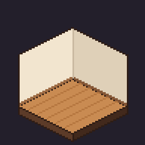
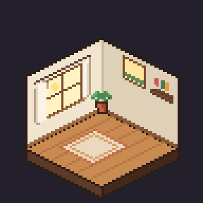
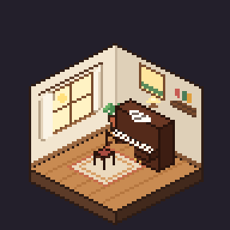

[English](README.md) | **ภาษาไทย**

# Aseprite MCP — คู่มือตั้งค่าสำหรับผู้ใช้ทั่วไป

โปรเจกต์นี้ทำให้ AI (เช่น Cursor, Claude Desktop, Antigravity) **วาด Pixel Art ลงในโปรแกรม Aseprite บนเครื่องคุณแบบสดๆ** คุณเห็นทุกเส้นบนผ้าใบ กด `Ctrl+Z` ย้อนกลับได้ และวาดด้วยเมาส์แทรกไปพร้อมกันได้

คู่มือนี้เขียนสำหรับคนที่**ยังไม่เคยตั้งค่าอะไรแนวนี้มาก่อน** ทำตามทีละขั้นได้เลย ไม่จำเป็นต้องเขียนโปรแกรมเป็น

---

## สิ่งที่คุณจะติดตั้งมี 3 ส่วน

1. **Aseprite** — โปรแกรมวาด Pixel Art (ต้องมีลิขสิทธิ์/ซื้อไว้แล้ว)
2. **Aseprite MCP Bridge** — ส่วนขยายเล็กๆ ใน Aseprite ที่คุยกับ AI
3. **เซิร์ฟเวอร์ Aseprite MCP** — โปรแกรมเล็กๆ บนเครื่องคุณ ที่แอป AI จะเปิดให้อัตโนมัติ

เมื่อตั้งค่าเสร็จ ให้เปิด Aseprite แล้วเปิดแอป AI จากนั้นพิมพ์ประมาณว่า:  
`สร้าง canvas 32x32 แล้ววาดแมวส้มน่ารักๆ`

---

## ก่อนเริ่ม — เช็คลิสต์

| สิ่งที่ต้องมี | รายละเอียด |
| --- | --- |
| ติดตั้ง Aseprite แล้ว | ลงผ่าน Steam หรือไฟล์ติดตั้งปกติก็ได้ |
| แอป AI ที่รองรับ MCP | Cursor, Claude Desktop หรือ Antigravity |
| เวลาประมาณ 10–15 นาที | ทำครั้งแรกครั้งเดียว |
| **Node.js เวอร์ชัน 20 ขึ้นไป** *(วิธีที่แนะนำ)* | ดาวน์โหลดฟรี: https://nodejs.org/ (เลือก LTS) |

ทางเลือกภายหลัง: ดาวน์โหลด **ไฟล์สำเร็จรูป (Release)** จากหน้า GitHub Releases ของโปรเจกต์นี้ (ไม่ต้องลง Node.js) — ใช้ได้เมื่อมีคนอัปโหลดไฟล์สำหรับระบบปฏิบัติการของคุณแล้ว

---

## ตอนที่ 1 — ดาวน์โหลดไฟล์โปรเจกต์

### วิธี A — ดาวน์โหลด ZIP (ไม่ต้องใช้ Git)

1. เปิดหน้า repository นี้บน GitHub
2. กดปุ่มสีเขียว **Code** → **Download ZIP**
3. แตกไฟล์ไปไว้ที่หาง่าย เช่น
   - Windows: `C:\Users\<ชื่อผู้ใช้ของคุณ>\aseprite_mcp`
   - macOS: `/Users/<ชื่อผู้ใช้ของคุณ>/aseprite_mcp`
4. จดที่อยู่โฟลเดอร์นี้ไว้ จะต้องวางในไฟล์ตั้งค่าทีหลัง

### วิธี B — ใช้ Git

```bash
git clone <ลิงก์-repo-นี้>
cd aseprite_mcp
```

แทน `<ลิงก์-repo-นี้>` ด้วย URL จริงของ repository

---

## ตอนที่ 2 — ติดตั้ง Node.js (ถ้ายังไม่มี)

1. เข้า https://nodejs.org/ แล้วติดตั้งเวอร์ชัน **LTS**
2. ปิดแล้วเปิดหน้าต่างเทอร์มินัลใหม่ (Windows ใช้ PowerShell, macOS ใช้ Terminal)
3. ลองพิมพ์:

```bash
node --version
```

ควรขึ้นเลขเวอร์ชันประมาณ `v20.x.x` หรือสูงกว่า ถ้าขึ้นว่าไม่รู้จักคำสั่ง ให้รีสตาร์ทเครื่องหนึ่งครั้งแล้วลองใหม่

---

## ตอนที่ 3 — ติดตั้งส่วนประกอบและสร้างไฟล์ใช้งาน

1. เปิดเทอร์มินัล**ในโฟลเดอร์โปรเจกต์**จากตอนที่ 1
   - ทริค Windows: เปิดโฟลเดอร์ใน File Explorer คลิกช่องที่อยู่ด้านบน พิมพ์ `powershell` แล้วกด Enter
2. รันทีละบรรทัด:

```bash
npm install
npm run build
```

ความหมายสั้นๆ:

- `npm install` ดาวน์โหลดไลบรารีที่จำเป็น (ทำครั้งเดียว)
- `npm run build` จะสร้าง
  - `dist/bin.js` — โปรแกรมที่แอป AI จะเรียกใช้
  - `dist/aseprite-mcp-bridge.aseprite-extension` — ไฟล์ปลั๊กอิน Aseprite
  - `dist/preview/` — ไฟล์สำหรับหน้าเว็บดูภาพสด

ถ้าคำสั่งพัง ให้ก๊อปข้อความ error ทั้งก้อน แล้วดูหัวข้อ [แก้ปัญหาเบื้องต้น](#แก้ปัญหาเบื้องต้น)

---

## ตอนที่ 4 — ติดตั้งปลั๊กอินลง Aseprite

### วิธีง่าย (แนะนำ)

ยังอยู่ในโฟลเดอร์โปรเจกต์ แล้วรัน:

```bash
node dist/bin.js install-plugin
```

จากนั้น**ปิด Aseprite ให้สนิท แล้วเปิดใหม่**

ตรวจผล: ใน Aseprite ไปที่ **Edit → Preferences → Extensions** ควรเห็น **Aseprite MCP Bridge** และมีติ๊กถูก

### วิธีลากวาง

1. เปิดโฟลเดอร์ `dist` ในโปรเจกต์
2. ลากไฟล์ `aseprite-mcp-bridge.aseprite-extension` ไปวางบนหน้าต่าง Aseprite
3. ถ้ามีหน้าต่างถามสิทธิ์ script / network ให้เลือกอนุญาตเต็มที่ (**Give full trust** หรือข้อความใกล้เคียง)
4. รีสตาร์ท Aseprite หนึ่งครั้ง
5. เช็คอีกครั้งที่ **Edit → Preferences → Extensions**

ภายหลังสามารถเปิด **File → MCP Bridge...** เพื่อดูสถานะ Connect / Disconnect ได้

---

## ตอนที่ 5 — หาที่อยู่ไฟล์ Aseprite

แอป AI ต้องรู้พาธเต็มไปยังโปรแกรม Aseprite (เพื่อให้วาดได้แม้ปิดหน้าต่างไว้)

### Windows (Steam)

1. เปิด Steam
2. คลิกขวาที่ **Aseprite** → **Manage → Browse local files**
3. ก๊อปที่อยู่โฟลเดอร์ แล้วต่อท้ายด้วย `\Aseprite.exe`

ตัวอย่างที่พบบ่อย:

- `C:\Program Files (x86)\Steam\steamapps\common\Aseprite\Aseprite.exe`
- `D:\SteamLibrary\steamapps\common\Aseprite\Aseprite.exe`

### macOS

พาธทั่วไป:

- `/Applications/Aseprite.app/Contents/MacOS/aseprite`

ถ้าลงผ่าน Steam อาจอยู่ที่:

- `~/Library/Application Support/Steam/steamapps/common/Aseprite/Aseprite.app/Contents/MacOS/aseprite`

### ทริค

ให้ตัวช่วยหาให้อัตโนมัติ:

```bash
node dist/bin.js setup --print
```

ดูค่า `ASEPRITE_PATH` ที่พิมพ์ออกมา ถ้าขึ้นว่าหาไม่เจอ ให้ใส่พาธเองในตอนที่ 6

---

## ตอนที่ 6 — เชื่อมกับแอป AI

คุณจะเพิ่มรายการชื่อ `"aseprite"` ในไฟล์ตั้งค่า MCP ของแอป AI

**แทนที่ตัวแปรเหล่านี้ด้วยของจริงบนเครื่องคุณ:**

- `<PROJECT>` → โฟลเดอร์โปรเจกต์จากตอนที่ 1  
ตัวอย่าง: `C:/Users/Alex/aseprite_mcp`
- `<ASEPRITE>` → ไฟล์โปรแกรม Aseprite จากตอนที่ 5  
ตัวอย่าง: `C:/Program Files (x86)/Steam/steamapps/common/Aseprite/Aseprite.exe`

บน Windows ในไฟล์ JSON ใช้ได้ทั้งสองแบบ:

- เครื่องหมาย `/`: `C:/Users/Alex/...`
- หรือ `\\` คู่: `C:\\Users\\Alex\\...`

### ทางลัด: ให้คำสั่ง setup เขียนไฟล์ให้

จากโฟลเดอร์โปรเจกต์:

```bash
# Cursor (เขียน .cursor/mcp.json ในโฟลเดอร์ปัจจุบัน หรือ ~/.cursor/mcp.json)
node dist/bin.js setup --cursor

# Claude Desktop
node dist/bin.js setup --claude

# Antigravity
node dist/bin.js setup --antigravity

# แค่พิมพ์ JSON ออกมาให้ก๊อปเอง
node dist/bin.js setup --print
```

### Cursor (ตั้งเอง)

สร้างหรือแก้ไฟล์ `.cursor/mcp.json` ในโปรเจกต์ (หรือตั้งค่า MCP แบบ Global ของ Cursor):

```json
{
  "mcpServers": {
    "aseprite": {
      "command": "node",
      "args": ["<PROJECT>/dist/bin.js"],
      "env": {
        "ASEPRITE_PATH": "<ASEPRITE>"
      }
    }
  }
}
```

จากนั้นเปิด **Cursor Settings → MCP** แล้วรีเฟรช / รีโหลด

### Claude Desktop (ตั้งเอง)

ที่อยู่ไฟล์ตั้งค่า:

- **Windows:** กด `Win+R` พิมพ์ `%APPDATA%\Claude` กด Enter แล้วเปิด `claude_desktop_config.json`
- **macOS:** `~/Library/Application Support/Claude/claude_desktop_config.json`

ใส่ส่วนนี้ใน `"mcpServers"` (อย่าลบเซิร์ฟเวอร์อื่นที่มีอยู่):

```json
{
  "mcpServers": {
    "aseprite": {
      "command": "node",
      "args": ["<PROJECT>/dist/bin.js"],
      "env": {
        "ASEPRITE_PATH": "<ASEPRITE>"
      }
    }
  }
}
```

ปิด Claude Desktop ให้สนิท (รวมไอคอนมุมขวาล่าง) แล้วเปิดใหม่

### Antigravity (ตั้งเอง)

แก้ไฟล์ `~/.gemini/config/mcp_config.json`  
(Windows: `C:\Users\<ชื่อผู้ใช้ของคุณ>\.gemini\config\mcp_config.json`)

```json
{
  "mcpServers": {
    "aseprite": {
      "command": "node",
      "args": ["<PROJECT>/dist/bin.js"],
      "env": {
        "ASEPRITE_PATH": "<ASEPRITE>"
      }
    }
  }
}
```

แล้วรีเฟรช MCP ในหน้า Antigravity (หรือเปิดแชทใหม่)

---

## ตอนที่ 7 — ทดสอบครั้งแรก

1. เปิด **Aseprite** ทิ้งไว้
2. เปิดแอป AI ของคุณ
3. พิมพ์:

```text
เช็คสถานะ Aseprite MCP ให้หน่อย
```

ถ้าสำเร็จ ระบบควรบอกว่าเชื่อมต่อแล้ว (Live) หรืออย่างน้อยเซิร์ฟเวอร์กำลังทำงาน

จากนั้นลอง:

```text
สร้าง canvas 32x32 แล้ววาดแมวส้มยิ้มแฉ่งแยกเลเยอร์ไว้ให้หน่อย
```

ดูหน้าต่าง Aseprite — ควรเห็นพิกเซลโผล่แบบสดๆ

### หน้าเว็บดูภาพสด (ไม่บังคับ)

ขณะที่แอป AI เปิด MCP อยู่ เปิดเบราว์เซอร์ไปที่:

- http://127.0.0.1:7777/ — หน้าดูภาพแบบสด
- http://127.0.0.1:7777/preview.png — รูปล่าสุดอย่างเดียว

ความหมายป้ายสถานะ:

- **LIVE** — เชื่อมกับ Aseprite ที่เปิดอยู่
- **HEADLESS** — วาดเบื้องหลังโดยไม่เปิดหน้าต่าง
- **DISCONNECTED** — ยังไม่เชื่อมหรือยังไม่มีภาพแรก

---

## การใช้งานประจำวัน

### วาดด้วยกัน (โหมด Live)

1. เปิด Aseprite ทิ้งไว้
2. สั่งงาน AI ตามปกติ
3. แต่ละคำสั่งวาดของ AI = 1 ขั้น Undo → กด `Ctrl+Z` ครั้งเดียวเพื่อย้อนขั้นนั้น
4. ใช้เครื่องมือใน Aseprite วาดแทรกได้ตลอด
5. ถ้าเป็น Animation กด `Enter` ใน Aseprite เพื่อดูพรีวิว

### วาดแม้ปิด Aseprite (โหมด Headless)

ถ้าใส่ `ASEPRITE_PATH` ถูกต้อง เซิร์ฟเวอร์ยังสั่งวาดเบื้องหลังได้ เปิดหน้าเว็บพรีวิวเพื่อดูความคืบหน้า แล้วค่อยสั่งเซฟหรือ export ไฟล์

### ตัวอย่างประโยคสั่งงาน

- `เช็คสถานะ Aseprite MCP ให้หน่อย`
- `สร้าง canvas 32x32 แล้ววาดแมวส้มน่ารักๆ แยกเลเยอร์ไว้`
- `แคปภาพจาก Aseprite มาดูว่าสัดส่วนโอเคไหม`
- `ทำเป็น Animation 4 เฟรม กระดิกหาง เฟรมละ 160 ms`
- `เพิ่มเลเยอร์ Shadow ความโปร่งแสง 50% โหมด multiply`
- `เซฟเป็น C:/art/cat.aseprite และ export เป็น C:/art/cat.gif`

ใช้ที่อยู่โฟลเดอร์ที่มีอยู่จริงบนเครื่องคุณ

---

## ทางเลือก — ไฟล์สำเร็จรูปจาก Releases

ถ้าโปรเจกต์นี้มี GitHub Releases สำหรับระบบของคุณ:

1. ดาวน์โหลดไฟล์ zip ของ Windows / macOS / Linux
2. แตกไปไว้ที่ถาวร เช่น `C:\Tools\aseprite-mcp\`
3. เก็บโฟลเดอร์ `aseprite-plugin` และ `preview` ไว้ข้างไฟล์ `.exe` (หรือ binary) อย่าลบ
4. รัน setup ครั้งหนึ่ง:

```bash
aseprite-mcp-windows-x64.exe setup --cursor
```

5. ใน MCP config ให้ `"command"` ชี้ไปที่ไฟล์นั้น และใส่ `"args": []`

```json
{
  "mcpServers": {
    "aseprite": {
      "command": "C:/Tools/aseprite-mcp/aseprite-mcp-windows-x64.exe",
      "args": [],
      "env": {
        "ASEPRITE_PATH": "<ASEPRITE>"
      }
    }
  }
}
```

---

## ทางเลือก — npm (เมื่อมีการ  แล้ว)

เมื่อแพ็กเกจ `@steper158x/aseprite_mcp` ขึ้น npm แล้ว สามารถใช้:

```bash
npx -y @steper158x/aseprite_mcp setup --cursor
```

และตั้งค่า MCP แบบนี้:

```json
{
  "mcpServers": {
    "aseprite": {
      "command": "npx",
      "args": ["-y", "@steper158x/aseprite_mcp"],
      "env": {
        "ASEPRITE_PATH": "<ASEPRITE>"
      }
    }
  }
}
```

จนกว่าจะ publish ให้ใช้ **ตอนที่ 1–6** (Node + โฟลเดอร์โปรเจกต์) หรือไฟล์สำเร็จรูปจาก Releases

---

## แก้ปัญหาเบื้องต้น

| อาการ | ลองทำแบบนี้ |
| --- | --- |
| ขึ้นว่าไม่รู้จักคำสั่ง `node` | ติดตั้ง Node.js LTS ใหม่ แล้วเปิดเทอร์มินัล**หน้าต่างใหม่** บน Windows อาจต้องรีสตาร์ทเครื่อง |
| แอป AI หา `node` ไม่เจอ | ใน MCP config ใส่พาธเต็มของ `node.exe` (Windows: รัน `where.exe node` ใน PowerShell) |
| ไม่เห็นปลั๊กอิน / Disconnected | **Edit → Preferences → Extensions** → เปิด **Aseprite MCP Bridge** → รีสตาร์ท Aseprite → **File → MCP Bridge... → Connect** ขณะเปิดแอป AI อยู่ |
| พอร์ต 7777 ชนกัน | อาจเปิดแอป AI สองตัวที่ใช้เซิร์ฟเวอร์นี้พร้อมกัน ปิดอันหนึ่ง หรือใส่ `"ASEPRITE_MCP_PORT": "7778"` ใน `env` |
| โหมด Headless ไม่ทำงาน | เช็คว่า `ASEPRITE_PATH` ชี้ไปที่ไฟล์ `Aseprite.exe` / `aseprite` จริง ไม่ใช่โฟลเดอร์ |
| setup เขียนไฟล์ผิดที่ | รัน setup จากในโฟลเดอร์โปรเจกต์ หรือใช้ `--print` ดูก่อนค่อยเขียน |
| หน้าพรีวิวว่าง | ให้แชทที่โหลด MCP ทำงานก่อน แล้วเปิด http://127.0.0.1:7777/ อีกครั้ง |

---

## การตั้งค่าเพิ่มเติม (ไม่บังคับ)

ใส่ในบล็อก `"env"` ของ MCP config เมื่อจำเป็นเท่านั้น:

| ชื่อ | ค่าเริ่มต้น | ความหมาย |
| --- | --- | --- |
| `ASEPRITE_PATH` | (ว่าง) | พาธ Aseprite สำหรับวาดแบบปิดหน้าต่าง |
| `ASEPRITE_MODE` | `auto` | `auto`, `live`, หรือ `headless` |
| `ASEPRITE_MCP_PORT` | `7777` | พอร์ตพรีวิวและการเชื่อมต่อ |
| `ASEPRITE_MCP_OPEN_PREVIEW` | `0` | ตั้ง `1` เพื่อเปิดหน้าพรีวิวตอนเซิร์ฟเวอร์เริ่ม |
| `ASEPRITE_MCP_ALLOW_LUA` | `0` | ตั้ง `1` เพื่อเปิดเครื่องมือขั้นสูง `run_lua` |

---

## ตัวอย่างผลงาน

| Animation แมวส้ม (32×32, 4 เฟรม) | ห้องเปียโน Isometric (96×96, 6 เลเยอร์, 4 เฟรม) |
| :---: | :---: |
|  |  |
| แมวส้มยิ้มแฉ่ง 4 เฟรม | ห้องเปียโนแยกเลเยอร์ |

| 1. โครงห้อง | 2. หน้าต่างและของแต่ง | 3. เปียโน | 4. คนเล่น | 5. แสงแดด |
| :---: | :---: | :---: | :---: | :---: |
|  |  |  |  |  |

---

## สำหรับนักพัฒนา

```text
แอป AI ──(stdio MCP)──► เซิร์ฟเวอร์ Node/Bun
                           ├─ Live  → WebSocket → ส่วนขยาย Aseprite
                           ├─ Headless → Aseprite -b --script
                           └─ หน้า Web Preview ที่พอร์ต 7777
```

คำสั่งที่ใช้บ่อยในโฟลเดอร์โปรเจกต์:

| คำสั่ง | ใช้ทำอะไร |
| --- | --- |
| `npm run build` | สร้าง `dist/bin.js` และปลั๊กอิน |
| `npm run start:node` | รันเซิร์ฟเวอร์ MCP ด้วย Node |
| `npm test` | รันเทส (ต้องมี Bun) |
| `node dist/bin.js setup --help` | ดูตัวเลือกตัวช่วยติดตั้ง |
| `node dist/bin.js install-plugin` | ติดตั้งส่วนขยายลง Aseprite |
| `node dist/bin.js package-plugin` | สร้างไฟล์ `.aseprite-extension` |

Bun ใช้ได้ตอนพัฒนา (`bun install`, `bun start`, `bun test`) แต่**ผู้ใช้ทั่วไปทำตามคู่มือนี้ด้วย Node.js ก็พอ**
